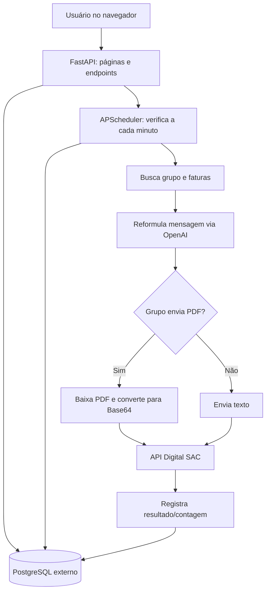

# Disparador de Mensagens

## 1. Apresentação

O Disparador é uma aplicação web para organizar mensagens de cobrança e programar seu envio a partir de grupos de faturas. A interface permite cadastrar mensagens e grupos, filtrar faturas, anexar PDFs e definir data/hora de envio. Um agendador consulta os agendamentos ativos e usa a API do Digital SAC para enviar mensagens.

O projeto também contém rotinas para importar planilhas de faturas, consultar dados de contratos e faturas no PostgreSQL, criar mensagens com apoio da API OpenAI e automatizar alguns relatórios via Selenium. Há scripts antigos e de Airflow no repositório, mas eles não são iniciados pelo Dockerfile atual.

O serviço principal é uma API **FastAPI** com páginas HTML e arquivos JavaScript. `app.py` é uma interface Streamlit separada e experimental; não é o processo iniciado pelo Docker.

## 2. Funcionalidades

### Grupos de mensagens

Um grupo guarda nome, convênios, estipulantes, status de contrato, alertas, fase de atraso, estado ativo e opção de envio com PDF. Os filtros são armazenados como JSON no PostgreSQL. A página inicial lista grupos; existem páginas para adicionar, visualizar e editar grupos.

Ao obter as faturas de um grupo, o serviço primeiro procura registros ainda não enviados em `upload_faturas`. Se não encontrar, consulta `relatorio_faturas` usando os filtros do grupo e limita a busca a faturas atualizadas na data atual. O filtro de fase usa um intervalo de dias no formato `mínimo-máximo` aplicado a `qtde_dias_atraso`.

### Upload de faturas

O endpoint `POST /upload_faturas_excel` recebe um `.xlsx`, o identificador do grupo e o nome do grupo. A planilha precisa conter as colunas `fatura` e `celular` (os títulos são convertidos para minúsculas e têm espaços externos removidos). Cada linha é inserida em `upload_faturas`.

O agendador busca as faturas do grupo e envia mensagens. O código filtra `upload_faturas.enviado = FALSE`, mas o fluxo de envio atual não marca esse campo como `TRUE`; essas faturas podem ser selecionadas novamente. Teste e operação devem considerar esse risco de reenvio.

### Cadastro e envio de mensagens

Mensagens têm texto, título e indicador ativo. A interface fornece páginas de listagem, cadastro e edição; a API permite criar, atualizar, consultar por ID e excluir.

Para cada agendamento, o serviço pega a primeira mensagem da lista `mensagem_ids`, busca as faturas do grupo e percorre os telefones. O texto passa por `reescrever_mensagem`, que chama a API OpenAI com o modelo configurado no código. Se o grupo estiver configurado com PDF, o sistema constrói a URL da fatura, baixa o PDF, converte-o para Base64 e envia o arquivo junto com o texto. Caso contrário, envia mensagem de texto.

As chamadas ao Digital SAC usam OAuth e os endpoints de mensagens, serviços/conexões e departamentos. O código oferece envio para contato existente, envio para número não cadastrado e envio com PDF. Os resultados de cada tentativa também são acrescentados a arquivos CSV no diretório de execução.

### Agendamentos

O formulário de agendamento associa grupo, data/hora, estado ativo, IDs de mensagens, conexão e departamento. O APScheduler roda uma verificação a cada minuto; a rotina busca os 10 agendamentos ativos mais recentes e dispara aqueles cujo horário coincide com o minuto atual. Os envios são executados em threads, com até cinco workers, e existe uma pausa aleatória de 5 a 15 segundos entre destinatários.

O código compara o horário pelo minuto exato. Não há mecanismo de recuperação de agendamentos perdidos enquanto a aplicação estava parada. A implantação atual inicia quatro workers Gunicorn, e cada worker importa a aplicação e inicia seu próprio APScheduler; isso pode gerar execuções duplicadas. Antes de usar agendamentos reais em produção, a execução do scheduler deve ser isolada em um único processo ou a configuração de workers deve ser revista.

Ao final do ciclo de envio, o projeto grava início, fim, quantidade de envios e falhas em `logs_envio`. A lista de agendamentos e a ação de exclusão também estão disponíveis pela API.

O fluxo atual também chama `envio_log` no começo e no fim, que envia mensagens de status para um número fixo definido no código. Além disso, as funções de envio podem capturar erros e retornar um objeto `error` sem lançar exceção; nesses casos, o agendador pode incrementar o contador de enviados mesmo sem confirmação de entrega. Revise esses pontos antes de usar a automação com destinatários reais.

### Usuários e autenticação

O formulário de cadastro cria usuários e armazena a senha com hash bcrypt. O login procura o e-mail na tabela `usuarios`, verifica o hash e grava os dados do usuário na sessão. Há também uma rota de logout.

O middleware redireciona páginas sem sessão para `/login`, mas libera caminhos `/api`, `/docs`, `/login`, `/static` e `/usuarios/cadastrar`. Portanto, as rotas sob `/api` não exigem a sessão definida pelo middleware. O CORS também está configurado para qualquer origem. Revise e restrinja essas regras antes de expor a aplicação publicamente.

### Consultas e dados externos

A API consulta `relatorio_contratos` e `relatorio_faturas`, que precisam existir no banco. Expõe listas de convênios, estipulantes, status, alertas, contratos, faturas e faturas associadas a um grupo.

Também consulta a API Digital SAC para retornar conexões ativas e departamentos. Os métodos de autenticação usam `BASE_URL_DIGITAL_SAC`, `USERNAME_DIGITAL_SAC` e `PASSWORD_DIGITAL_SAC`.

### Rotinas complementares

- `src/api_module/gera_mensagem_ia.py` reformula o texto antes do envio. Em caso de falha, retorna o texto recebido.
- `src/automacoes/` contém rotinas de carga de planilhas e scripts de relatório.
- `src/plugins/` contém diversos extratores e automações Selenium. Eles não são iniciados pelo `src.api:app` nem pelo Dockerfile atual.
- `dags/` contém arquivos de DAG do Airflow, mas Airflow não está instalado nem configurado no Compose deste projeto.
- `app.py` contém uma pequena interface Streamlit que consulta mensagens da API Digital SAC; não é parte do container FastAPI.

### Páginas e endpoints principais

O FastAPI publica as páginas abaixo, além dos arquivos em `/static`:

| Rota | Uso |
| --- | --- |
| `/login` | Formulário de autenticação |
| `/`, `/grupos/`, `/add`, `/edit/{group_id}`, `/view/{group_id}` | Lista, cria, edita e visualiza grupos |
| `/agendamento/add`, `/agendamentos/` | Cria e lista agendamentos |
| `/mensagens/`, `/mensagens/add`, `/mensagens/edit/{mensagem_id}` | Lista, cria e edita mensagens |
| `/usuarios/cadastrar` | Formulário de cadastro de usuário |
| `/docs` | Documentação OpenAPI interativa do FastAPI |

Endpoints de dados e ações usados pela interface/API:

| Método e rota | Função |
| --- | --- |
| `POST /login`, `GET /logout` | Login por formulário e logout da sessão |
| `GET/POST /mensagens`, `PUT/DELETE /mensagens/{id}`, `GET /mensagens/view/{id}` | CRUD de mensagens |
| `GET/POST /grupos`, `GET/PUT/DELETE /grupos/{id}`, `GET /grupos/{id}/faturas` | CRUD de grupos e consulta das faturas selecionadas |
| `POST /upload_faturas_excel` | Importa faturas de arquivo Excel para um grupo |
| `GET /convenios`, `/estipulantes`, `/status-contrato`, `/alerta-contrato` | Opções derivadas de contratos no banco |
| `GET /tb-contratos/{page}/{qtd}`, `GET /tb-faturas` | Consulta das tabelas de contratos/faturas |
| `GET /conexoes-ativas`, `/departamentos` | Consulta de opções na API Digital SAC |
| `POST/GET /api/agendamentos`, `DELETE /api/agendamento/{id}` | Cria/lista/remove agendamentos |
| `GET /config.js`, `/componentes/navbar.html` | Configuração auxiliar do frontend e componente de navegação |

`GET /tables/{table}/{page}/{qtd}` também está declarado, mas os nomes dos parâmetros da rota e da função não coincidem integralmente; consulte `/docs` e valide antes de depender desse endpoint. O middleware atual deixa todos os caminhos iniciados por `/api` sem autenticação de sessão.

## 3. Tecnologias

| Tecnologia | Uso no projeto |
| --- | --- |
| Python 3.10 | Runtime especificado no Dockerfile |
| FastAPI, Starlette e Uvicorn | API HTTP, middleware e servidor ASGI |
| Gunicorn com worker Uvicorn | Servidor usado no container, configurado com quatro workers |
| PostgreSQL e psycopg2 | Persistência e acesso aos dados |
| APScheduler | Verificação periódica dos agendamentos |
| Pydantic Settings | Carregamento e validação das configurações obrigatórias |
| Requests | Chamadas ao Digital SAC e downloads HTTP |
| OpenAI Python SDK | Reformulação das mensagens |
| pandas e openpyxl | Leitura de planilhas Excel |
| Passlib e bcrypt | Hash e verificação de senhas |
| Jinja2 | Renderização de páginas HTML |
| Selenium e AntiCaptcha | Scripts de automação de navegador presentes no repositório |
| Streamlit | Interface auxiliar em `app.py` |
| Docker / Docker Compose | Build e execução do serviço API |
| JavaScript, HTML e CSS | Interface web entregue por FastAPI |

As versões de bibliotecas Python estão listadas em `requirements.txt`; `gunicorn` aparece sem versão fixada. O Dockerfile usa `python:3.10-slim`.

## 4. Configuração do ambiente local

### 4.1 Dependências

Para executar pelo Python no host, instale Python 3.10 e crie um ambiente virtual na raiz do projeto:

```powershell
py -3.10 -m venv venv
\.\venv\Scripts\Activate.ps1
python -m pip install --upgrade pip
pip install -r requirements.txt
```

Linux/macOS:

```sh
python3.10 -m venv venv
source venv/bin/activate
python -m pip install --upgrade pip
pip install -r requirements.txt
```

Se o PowerShell bloquear a ativação de scripts, use o Python do ambiente diretamente, por exemplo `venv\Scripts\python.exe -m uvicorn ...`.

### 4.2 Variáveis de ambiente

O arquivo `config/settings.py` declara estes campos como obrigatórios ao importar a API:

| Variável | Finalidade no código |
| --- | --- |
| `ANTI_CAPTCHA_API_KEY` | Scripts Selenium que tentam resolver CAPTCHA |
| `SISTEMA_LOGIN`, `SISTEMA_SENHA`, `BASE_URL` | Credenciais/URL para as automações do sistema de relatórios |
| `OPENAI_API_KEY` | Cliente OpenAI usado para reformular mensagens |
| `USERNAME_DIGITAL_SAC`, `PASSWORD_DIGITAL_SAC`, `BASE_URL_DIGITAL_SAC` | Autenticação e chamadas ao Digital SAC |
| `contato` | Campo exigido pelo Settings; não foi encontrado uso no fluxo principal atual |
| `DB_HOST`, `DB_NAME`, `DB_USER`, `DB_PASSWORD`, `DB_PORT` | Conexão ao PostgreSQL |
| `SECRET_KEY` | Assinatura da sessão web; use valor longo e privado |
| `API_URL` | URL pública retornada por `/config.js`; diversos arquivos JavaScript ainda têm URL fixa e não usam esse valor de forma consistente |

Crie `.env` na raiz e defina todos os 16 campos obrigatórios acima. O `.env.example` atual está incompleto: ele não contém todos os campos exigidos por `config/settings.py`, portanto copiá-lo sozinho não basta para inicializar a API. As automações antigas também leem `LOGIN_USUARIO` e `LOGIN_SENHA`, mas esses campos não substituem `SISTEMA_LOGIN` e `SISTEMA_SENHA` no Settings.

O `.env` real está ignorado pelo Git. Não coloque chaves, senhas ou tokens no README, no `.env.example` ou em commits. O código atual contém credenciais de fallback/teste em alguns módulos de conexão; não use esses valores. Remova-os e troque credenciais que possam ser válidas antes de publicar o repositório.

### 4.3 Banco de dados

O `docker-compose.yaml` deste repositório **não cria um PostgreSQL**. Ele espera uma rede Docker externa chamada `etl_contem_my_network` e um banco acessível nessa rede (na configuração existente, o host esperado costuma ser informado em `DB_HOST`). O Compose do outro projeto ETL pode fornecer essa rede e o banco; confirme que ambos estão ativos e que o banco é o correto antes de subir o Disparador.

O arquivo `config/schema/datatables.sql` contém parte do esquema do aplicativo (grupos, agendamentos, mensagens, usuários, logs e upload de faturas), mas não é executado automaticamente e não é autocontido: por exemplo, cria índice sobre `relatorio_contratos`, que deve existir previamente. O código também espera `relatorio_faturas`. Prepare primeiro as tabelas de origem e aplique somente o SQL necessário, uma vez, em um banco de desenvolvimento vazio. O script contém `CREATE TABLE`/`ALTER TABLE` sem migração idempotente; não o execute repetidamente em um banco já configurado.

## 5. Executar e testar localmente

### 5.1 Rodar a API

Na raiz do projeto, com o ambiente virtual ativo, `.env` completo e PostgreSQL acessível:

```powershell
python -m uvicorn src.api:app --reload --host 127.0.0.1 --port 8000
```

Linux/macOS:

```sh
python -m uvicorn src.api:app --reload --host 127.0.0.1 --port 8000
```

O serviço local fica em `http://127.0.0.1:8000`. A documentação interativa da API fica em `/docs`. O endpoint `/` redireciona para o login se não houver sessão; as páginas também incluem `/grupos/`, `/mensagens/` e `/agendamentos/`.

O middleware libera `/docs`, então essa rota permite conferir a lista de endpoints. Teste primeiro leituras não destrutivas em um banco de desenvolvimento. O repositório não apresenta uma suíte automatizada de testes configurada; `src/test.py` é um script simples de conexão PostgreSQL, não um conjunto de testes.

**Não crie agendamentos de teste no banco de produção.** A API inicia o scheduler quando importa `src.api`, e o scheduler pode enviar mensagens reais. Use um banco separado sem agendamentos ativos e credenciais de sandbox. Não execute automações de cobrança de `src/plugins` com dados reais durante validação.

### 5.2 Teste da interface

Abra `http://127.0.0.1:8000/login`, autentique com um usuário já existente na tabela `usuarios` ou cadastre um pela rota `/usuarios/cadastrar`, e navegue pelas telas de grupos, mensagens e agendamentos. A interface usa JavaScript que chama endpoints da API.

Há URLs de API fixas em vários arquivos JavaScript. Assim, rodar a interface local não garante que as chamadas do navegador apontem para `127.0.0.1`; o valor de `API_URL` sozinho não corrige todos os arquivos. O navegador também pode bloquear chamadas HTTP a partir de um site HTTPS por conteúdo misto. Esse comportamento precisa ser corrigido no frontend para uma instalação nova ou domínio diferente.

### 5.3 Docker local

O Compose define somente o serviço `api`, publica `8000:8000`, carrega `.env` e conecta à rede externa `etl_contem_my_network`. Primeiro confira a rede:

```powershell
docker network inspect etl_contem_my_network
```

Se ela não existir, inicie a stack que fornece o banco ou crie uma rede Docker e conecte nela um PostgreSQL de desenvolvimento. Criar apenas a rede não cria nem configura o banco.

Depois:

```powershell
docker compose -f docker-compose.yaml config --services
docker compose -f docker-compose.yaml up --build -d
docker compose -f docker-compose.yaml ps
docker compose -f docker-compose.yaml logs -f api
```

Pare sem apagar imagens ou banco externo:

```powershell
docker compose -f docker-compose.yaml down
```

## 6. Deploy no EasyPanel

O repositório tem um Dockerfile de aplicação e um Compose que só executa a API. Para uma instalação simples, use o tipo **App** do EasyPanel com o Dockerfile; use o serviço Compose apenas se quiser preservar a rede externa definida no Compose e souber que ela existe no servidor. Consulte a [documentação oficial de App Services](https://easypanel.io/docs/services/app) e a [documentação de Dockerfile/builders](https://easypanel.io/docs/builders).

### 6.1 Opção recomendada: App com Dockerfile

1. Envie o projeto para um repositório GitHub. Mantenha-o privado até revisar as planilhas, CSVs e segredos presentes no histórico.
2. No EasyPanel, crie um Project e escolha **New Service → App**.
3. Selecione **GitHub** como fonte e configure o repositório, branch e Build Path `/`.
4. Selecione o builder **Dockerfile** e o arquivo `Dockerfile` na raiz. O Dockerfile instala `requirements.txt` e inicia Gunicorn/Uvicorn na porta `8000`.
5. Cadastre no ambiente do serviço todos os campos obrigatórios da seção 4.2, com valores válidos do servidor. Não use variáveis de build para segredos.
6. Configure o acesso ao PostgreSQL. O host e porta devem ser alcançáveis pela rede do container; o projeto atual não provisiona banco. Se o banco estiver em outro serviço Easypanel, use o hostname privado e as credenciais indicadas por esse serviço.
7. Configure um domínio HTTPS apontando para a porta interna `8000`.
8. Faça Deploy e verifique a saída do build e os logs do serviço.

O Easypanel usa Build Path `/` para projetos na raiz e permite selecionar Dockerfile como builder. O domínio deve apontar para a porta onde o processo realmente escuta. As ações do serviço incluem Deploy, Start/Stop, Restart, Force Rebuild e Logs. Alterações de configuração só entram em execução depois de Deploy. [App Services](https://easypanel.io/docs/services/app)

### 6.2 Opção Compose

Se importar o `docker-compose.yaml` como serviço Compose:

- Configure o Build Path como `/` e o arquivo `docker-compose.yaml`.
- Cadastre as variáveis no ambiente Compose. Como o arquivo declara `env_file: .env`, habilite a criação desse arquivo no Easypanel para que o Compose o encontre.
- Garanta que `etl_contem_my_network` exista no host Docker e que o container da API possa se conectar ao PostgreSQL nessa rede. Uma rede externa inexistente impede a criação do serviço.
- Configure domínio para o serviço `api`, porta interna `8000`.
- O Compose fixa `container_name: disparador` e publica `8000:8000`; o Easypanel pode alertar sobre nome fixo e colisão de porta. Prefira o roteamento de domínio do painel e ajuste esses campos na configuração de deploy se necessário.

O serviço Compose deste repositório não inclui Postgres, volume de dados ou serviço de backup. O banco continua sendo dependência externa. O Easypanel documenta fontes Git, configuração de ambiente e avisos de compatibilidade para `container_name` e `ports` no [Compose Service](https://easypanel.io/docs/services/compose).

### 6.3 Persistência e produção

O Compose não declara volume persistente para o container da API. Dados primários ficam no PostgreSQL externo. Os CSVs de resultado são gravados no diretório atual do container e podem desaparecer quando o serviço é recriado; configure armazenamento persistente antes de depender deles como histórico.

O container usa quatro workers Gunicorn, mas `src.api` inicia APScheduler durante a importação. Isso pode inicializar quatro schedulers e duplicar envios. Resolva essa arquitetura antes de ativar agendamentos de cobrança em produção. Revise também a autorização das rotas `/api`, CORS permissivo, URLs hardcoded no JavaScript, credenciais/fallbacks no código e arquivos de dados antes de publicar o domínio.

## 7. Operação em produção

### Iniciar, reiniciar e atualizar

- Use **Start** para iniciar o serviço parado.
- Use **Restart** para reiniciar a versão implantada atual.
- Para publicar uma nova branch/commit ou aplicar mudanças de ambiente, salve a configuração e faça **Deploy**.
- Use **Force Rebuild** quando precisar construir novamente sem cache.
- Só habilite deploy automático do GitHub depois de validar o fluxo de branch e build.

### Logs e monitoramento

Consulte os logs do serviço `api` no EasyPanel. Em execução Docker Compose local, use `docker compose -f docker-compose.yaml logs -f api`. As mensagens do scheduler e do fluxo de envio aparecem em stdout. A API não define endpoint próprio de healthcheck no Dockerfile/Compose. A rota `/docs` confirma que o processo FastAPI responde, mas não testa banco, token do Digital SAC nem envio.

Os registros de quantidade por execução são gravados em `logs_envio`, se o envio terminar o fluxo de log. Arquivos CSV diários de resultado são gravados localmente pelo código de automação; a retenção depende de armazenamento persistente configurado fora do Compose atual.

### Consultas para suporte

As tabelas da aplicação incluem `usuarios`, `grupo_mensagens`, `mensagens`, `agendamentos`, `logs_envio` e `upload_faturas`. As tabelas `relatorio_contratos` e `relatorio_faturas` são de dependência externa e devem estar atualizadas para montar grupos por filtros. A rotina de envio seleciona apenas os 10 agendamentos ativos mais recentes.

## 8. Estrutura do projeto

```text
.
├── app.py                         # Interface Streamlit auxiliar (não é o Docker entrypoint)
├── Dockerfile                     # Imagem FastAPI/Gunicorn, porta 8000
├── docker-compose.yaml            # Serviço API e rede externa; não inclui banco
├── requirements.txt               # Dependências Python
├── config/
│   ├── settings.py                 # Variáveis obrigatórias via Pydantic Settings
│   ├── conn.py                     # Wrapper PostgreSQL
│   ├── SCRPT1.sql                  # SQL legado/manual
│   └── schema/datatables.sql       # Parte do schema do app; pressupõe tabelas ETL
├── dags/                           # DAGs Airflow presentes, sem Airflow no Compose
├── docs/                           # Planilhas de referência/mapeamento
├── pages/                          # HTML servido por FastAPI/Jinja2
├── static/                         # JavaScript, CSS, imagens e DataTables
└── src/
    ├── api.py                      # Aplicação FastAPI, middleware, scheduler e páginas
    ├── scheduler.py                # Polling de agendamentos e envio
    ├── api_module/                 # Auth Digital SAC, mensagens, PDFs e OpenAI
    ├── automacoes/                 # Importação e extração auxiliar
    ├── middlewares/                # Redirecionamento por sessão
    ├── models/                     # Modelos de entrada Pydantic
    ├── plugins/                    # Scripts auxiliares/legados
    ├── routers/                    # Rotas HTTP
    ├── services/                   # Consultas, CRUD e regras de negócio
    └── utils/                      # Segurança, logs e Selenium
```

## 9. Fluxo de funcionamento



O fluxo começa quando usuário cadastra grupo, mensagem e agendamento. A aplicação grava esses dados no banco. A cada minuto, o scheduler consulta agendamentos ativos e compara o horário; quando coincide, carrega a primeira mensagem configurada e as faturas do grupo, pede a reformulação do texto, envia pela API Digital SAC e registra os totais. O PDF é baixado e anexado quando a opção do grupo está ligada.

## 10. Solução de problemas

| Sintoma | Causa provável | Verificação/correção |
| --- | --- | --- |
| API termina ao iniciar com erro de configuração | Um ou mais campos obrigatórios do `Settings` faltam no `.env` | Confira os 17 campos da seção 4.2; o `.env.example` atual não está completo. |
| Erro de conexão com PostgreSQL | Host/porta inacessível, credenciais divergentes ou rede externa ausente | Valide `DB_HOST`, `DB_NAME`, `DB_USER`, `DB_PASSWORD`, `DB_PORT`; no Docker, confirme rede e conectividade do container. |
| `docker compose up` falha ao localizar rede | `etl_contem_my_network` não existe | Inicie a stack que cria essa rede ou crie uma rede local e conecte o banco de desenvolvimento nela. |
| API abre, mas uma tela não carrega dados | JavaScript usa URL de backend fixa, bloqueio CORS/cookie, sessão ou API sem banco | Verifique Network/Console do navegador, URL chamada, sessão e logs da API; mudar apenas `API_URL` não atualiza todos os arquivos JS. |
| Grupos/listas falham no banco | Tabelas `relatorio_contratos`/`relatorio_faturas` ou schema do aplicativo ausentes | Prepare schema do ETL e aplique os SQLs do app conforme ambiente; os arquivos não são aplicados automaticamente. |
| Mensagem agendada não envia | Horário perdido, agendamento inativo, sem faturas elegíveis, credencial/token inválido ou filtro de grupo sem resultado | Verifique timezone e minuto cadastrado, logs do scheduler, status do grupo, tabelas e credenciais do Digital SAC. |
| Mensagens são enviadas em duplicidade | Vários workers iniciam schedulers; ou faturas não são marcadas como enviadas | Não rode agendamentos em produção até isolar o scheduler e corrigir o estado de envio. |
| Reescrita da mensagem falha | `OPENAI_API_KEY` ausente/inválida ou indisponibilidade do serviço | Confira a variável e o log; o código retorna o texto original quando essa função captura a falha. |
| PDF não é anexado | URL da fatura indisponível, falha no download ou API rejeita payload | Verifique o código da fatura, acesso HTTP, resposta do Digital SAC e logs. |
| EasyPanel build falha | Build Path/Dockerfile errado ou dependência incompatível | Use raiz `/`, Dockerfile da raiz, veja saída do build e valide `requirements.txt`. |
| Deploy funciona mas o banco não | App/Compose não provisiona PostgreSQL | Configure uma instância PostgreSQL externa alcançável pela rede e cadastre schema e variáveis. |

## 11. Segurança e dados

- Não publique `.env`, credenciais, planilhas de cobrança, CSVs de envio ou dados pessoais.
- A raiz contém CSVs operacionais e `docs/` tem arquivos Excel; revise esses arquivos antes de tornar o repositório público. Este README não assume que sejam dados fictícios.
- Troque credenciais de banco que tenham sido embutidas em exemplos/fallbacks do código e elimine defaults inseguros.
- Use HTTPS e um `SECRET_KEY` forte. Restrinja CORS e proteja as rotas `/api` antes de expor o serviço.
- Faça backup do PostgreSQL e dos arquivos de resultado antes de atualizar ou alterar volumes.
- Não valide agendamento com números reais; use sandbox e banco sem dados de cobrança.
